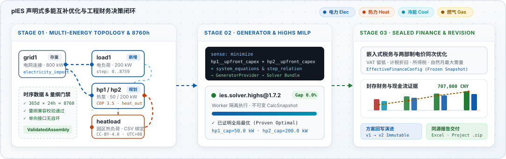
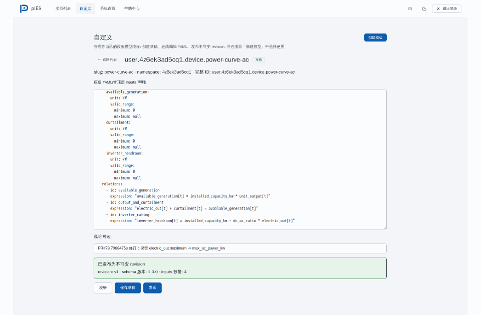
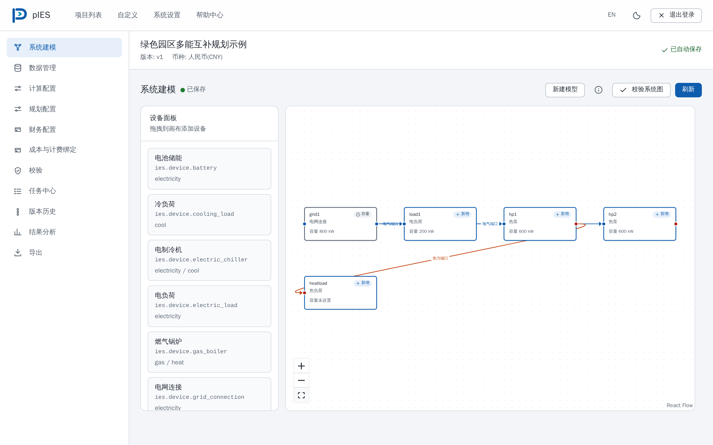
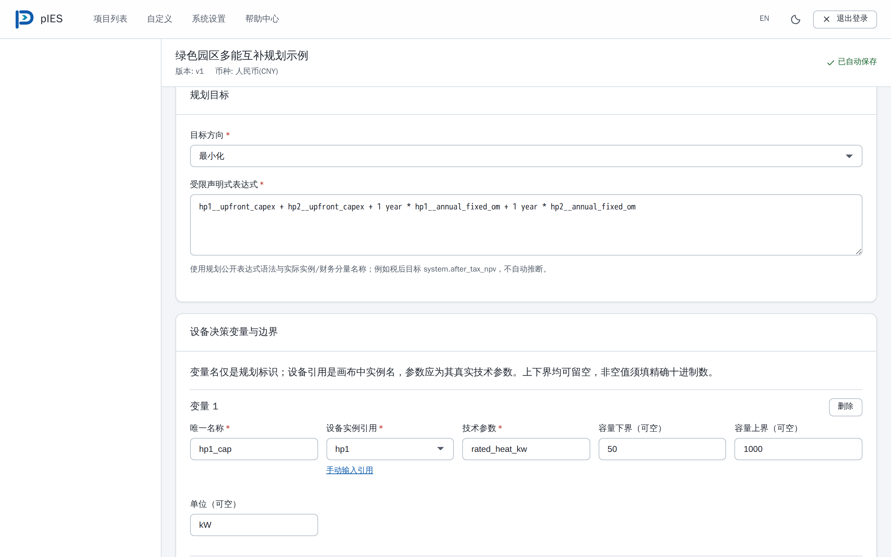
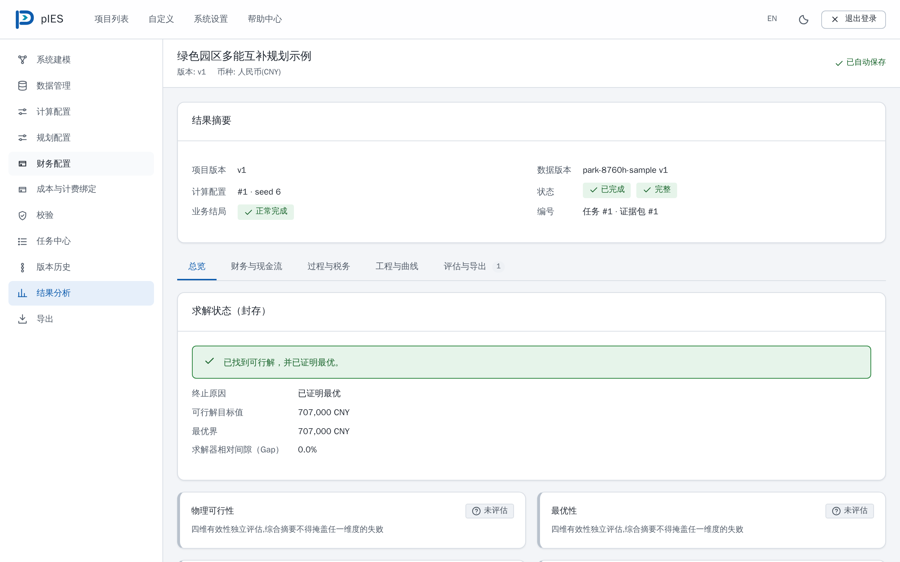
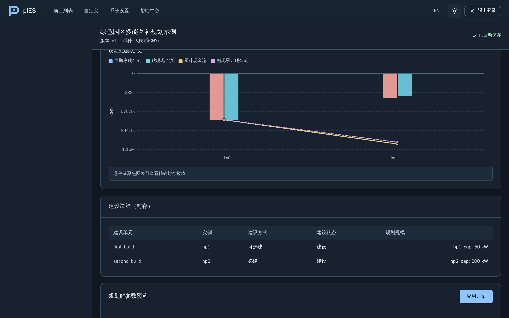
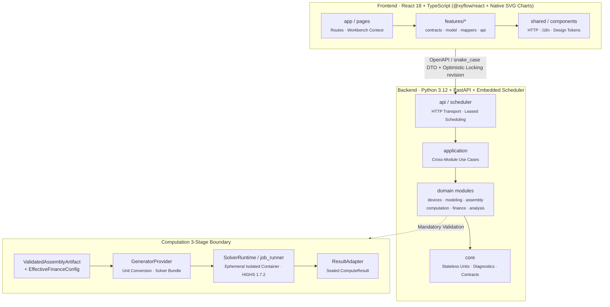

<div align="center">
  

  <h1>pIES — Integrated Energy System Planning &amp; Decision Platform</h1>

  <p>
    <strong>Multi-energy topology modeling, 8760-hour co-optimization, and embedded engineering financial evaluation for low-carbon campuses and buildings</strong><br />
    <em>Transparent Physics · Declarative Constraints · HiGHS MILP Co-Optimization · Single-Source Immutable Evidence &amp; Reports</em>
  </p>

  <p>
    <a href="LICENSE"></a>
    
    
    
    
    <a href="manual/changelog/en-US/README.md#current-version-status"></a>
  </p>

  <p>
    <a href="README.md">简体中文</a> · <strong>English</strong> &nbsp;|&nbsp;
    <a href="#-live-end-to-end-system-tour">Live Tour</a> ·
    <a href="#-why-pies">Why pIES</a> ·
    <a href="#-core-engineering-capabilities">Capabilities</a> ·
    <a href="#-declarative-kernel--open-architecture">Architecture</a> ·
    <a href="#-3-step-quickstart-docker">Quickstart</a> ·
    <a href="#-official-documentation-portal">Documentation</a>
  </p>

  <br />

  
</div>

---

## 🎬 Live End-to-End System Tour

All walkthrough frames and UI screenshots below come from a real **Campus Integrated Energy Planning Benchmark** (`20 MW` grid connection + `3,125 kW` PV + `5,000 kWh / 2,500 kW` battery + 14 bound 30-minute load, PV, and monthly TOU tariff CSVs, solved to global optimality at `Gap 0.0%` by built-in **HiGHS 1.7.2 MILP**):

<p align="center">
   14 30-min datasets bound -> topology & battery parameters -> system equations & objective -> E=26a optimal summary -> 438,288-step dispatch curves" width="90%" />
</p>

### Workbench Gallery (Modeling · Planning · Evaluation · Time-Series Curves)

<table>
  <tr>
    <td width="50%" align="center">
      <br />
      <sub><strong>1. Declarative Multi-Energy Canvas &amp; Inspector</strong> — <code>grid</code> (20 MW), <code>pv_existing</code> (3.125 MW), and <code>battery</code> (5,000 kWh / 2,500 kW) wiring with existing/new asset mixing</sub>
    </td>
    <td width="50%" align="center">
      <br />
      <sub><strong>2. System Equations &amp; Optimization Objective</strong> — Explicit <code>system_equations: allocation</code> rules paired with a constrained <code>maximize system.after_tax_npv</code> objective</sub>
    </td>
  </tr>
  <tr>
    <td width="50%" align="center">
      <br />
      <sub><strong>3. Immutable Solve Evidence &amp; Multi-Year Evaluation</strong> — 14 30-min datasets co-solved over <code>E=26 (K=1, N=25)</code> to proven optimality (<code>Gap 0.0%</code>)</sub>
    </td>
    <td width="50%" align="center">
      <br />
      <sub><strong>4. High-Resolution 438,288-Step Dispatch Curves</strong> — Lossless full-resolution window inspection (<code>step 0–999</code>) comparing PV output, grid exchange, and storage cycling</sub>
    </td>
  </tr>
</table>

---

## 💡 Why pIES?

As campus and building energy systems evolve from single-carrier supply toward multi-energy integration (*generation–grid–load–storage*), planning teams and researchers often face a dilemma: **commercial black boxes cannot be audited, while manual Excel models cannot jointly co-optimize 8760-hour coupled dispatch and tax cash flows**. pIES bridges graphical modeling, mathematical programming, and engineering economics into a single traceable loop:

| Dimension | Black-Box Tools / Manual Excel | pIES Integrated Loop |
| :--- | :--- | :--- |
| **Topology & Units** | Separate electrical/thermal/cooling models prone to unit mismatches | Unified electricity/heat/cooling/gas port topology with strict backend dimensional, directional, and closure gates |
| **Sizing & Dispatch Coupling** | Typical-day approximations or sequential size-then-simulate workflows missing arbitrage limits | Joint **HiGHS MILP** co-optimization of equipment capacities and full `8760h` (`15/30/60 min`) continuous-step dispatch |
| **Tariffs & Tax Accounting** | Static flat tariffs and offline spreadsheet depreciation/tax schedules decoupled from dispatch | Regional `FinanceProfile` + project overrides compile into an immutable snapshot; two-part monthly demand peaks, VAT credit pools, and tax depreciation participate directly in the solve |
| **Auditability & Delivery** | Edits overwrite spreadsheets, causing UI figures and reported Excel totals to drift | Immutable `CalcSnapshot` sealing; UI charts, applied planning revisions, and bilingual Excel exports consume the exact same sealed evidence |

---

## 🚀 Core Engineering Capabilities

1. **High-Fidelity Equipment Catalog & Mixed Assets**: Built-in `pv`, `battery`, `heat_pump`, `gas_boiler`, `electric_chiller`, `grid_connection`, `transport_pipe`, and multi-carrier loads, plus project-scoped custom model templates ([Models & Algorithms](manual/developer-guide/en-US/customization-center.md)) and mixed `existing` / `new` sizing.
2. **8760h Time-Series Validation & Built-In Samples**: Non-leap 365-day CSV ingestion (`step` or fixed UTC offset timestamps) with per-row structural diagnostics and one-click sample dataset generation.
3. **Full-Lifecycle Finance & 4D Assessment**: Construction installment schedules (`payments`), periodic renewals (`maintenance_expenses`), static/dynamic payback, NPV, classified FIRR states, and [baseline difference comparisons](manual/user-guide/en-US/results-and-exports.md) with explicit tax boundaries ([Concepts, Units, and Limits](manual/user-guide/en-US/concepts-and-limits.md)).
4. **Revision Lineage & Offline Project Packages**: Apply optimal capacities back into immutable project `Revision` snapshots, or export self-contained `.zip` archives with conflict-aware offline import proposals.

---

## 🔧 Declarative Kernel & Open Architecture

pIES prioritizes **openness over premature optimization, correctness over legacy compatibility, and explicit verifiable boundaries**, keeping extensions, long-term maintenance, and verification decoupled behind static contracts:



- **Declarative Equations & Constraints**: Express custom system balances, cross-step storage/ramping dynamics (`step_relation`), and financial component limits (`amount_relation`) declaratively via `system_equations` without modifying the generic solver runtime.
- **Zero-Trust Validation Boundaries**: Backend services authoritatively validate device YAML, assembly YAML, finance JSON, and calculation configs; the frontend retains unsaved form inputs verbatim upon `409` conflicts or `422` field diagnostics.
- **Automated Quality Gates**:
  - Backend [test_architecture_gates.py](backend/tests/test_architecture_gates.py): Pure Python AST checks enforcing strict boundary isolation across `core`, domain modules, `application`, `api`, and `worker`;
  - Frontend logic suite ([frontend/tests/](frontend/tests/)): 27 pure logic test suites plus offline static Help Center manifest verification.

---

## ⚡ 3-Step Quickstart (Docker)

The entire stack runs inside Docker Compose as **5 persistent core containers** (`postgres` + `redis` + `job_runner` + `backend` + `web`) plus a one-shot `builtin_stages` image build (`pies-builtin-stages:1.2.0`), with no host Python, Node, or HiGHS dependencies required.

### 1. Build and Start All Services

```bash
git clone https://github.com/ThermalEng/pIES.git
cd pIES
docker compose up -d --build
```

> [!NOTE]
> **Upgrading from `1.1.0`**: `1.1.5` converges the former persistent `io_worker` and `compute_worker` daemons into the `backend` embedded scheduler and ephemeral network-isolated stage containers orchestrated via `job_runner`. When upgrading from `1.1.0`, run with `--remove-orphans` so deprecated worker containers are cleanly removed:
> ```bash
> docker compose up -d --build --remove-orphans
> # Or remove old containers first:
> # docker compose down --remove-orphans && docker compose up -d --build
> ```

Once healthy (verify via `curl http://localhost:8080/api/readyz`):
- **Web Workbench**: `http://localhost:8080`
- **Built-In Offline Help Center**: `http://localhost:8080/help/` (compiled directly from `manual/` at frontend build time; readable even offline)

### 2. Sign In and Explore the Built-In Benchmark

- Default seeded admin username is `admin`, with initial password configured via `IESPLAN_DEFAULT_ADMIN_PASSWORD` (mandatory password rotation on first login).
- Create an engineer account and walk through: **Drag & drop multi-energy topology → Generate built-in 8760h sample data → Bind FinanceProfile & tariffs → Run validation precheck → Submit HiGHS optimization → Inspect sealed financials & export bilingual Excel reports**.

### 3. Run Architecture Gates & Tests (Inside Docker)

```bash
# Backend architecture gates & unit tests
docker compose exec backend pytest tests/test_architecture_gates.py

# Frontend production build, Help Center manifest & logic tests
docker build --target build -f frontend/Dockerfile -t pies-fe-check . && \
  docker run --rm pies-fe-check node scripts/run-logic-tests.mjs
```

> [!CAUTION]
> **Production Security Notice**: Rotate the default admin password, database credentials, and `IESPLAN_SECRET_KEY` before external exposure, and terminate TLS/HTTPS at a reverse proxy. See the [Deployment & Operations Guide](manual/developer-guide/en-US/deployment.md) for full configuration and ephemeral compute container isolation parameters.

---

## 📚 Official Documentation Portal

[`manual/`](manual/README.md) is the single authoritative source of long-term documentation (also served inside the Web UI Help Center):

| Section | Contents |
| :--- | :--- |
| 📖 **[User Guide](manual/user-guide/README.md)** ([EN](manual/user-guide/en-US/README.md) \| [中文](manual/user-guide/zh-CN/README.md)) | Sign-in & projects, canvas modeling, CSV preparation, financial & planning configs, task troubleshooting, and Excel/package exports |
| 🛠️ **[Developer Guide](manual/developer-guide/README.md)** ([EN](manual/developer-guide/en-US/README.md) \| [中文](manual/developer-guide/zh-CN/README.md)) | [Architecture Constitution](manual/developer-guide/en-US/ARCHITECTURE_CONSTITUTION.md), [System Architecture](manual/developer-guide/en-US/architecture.md), [File Formats](manual/developer-guide/en-US/file-formats.md), [Frontend Guide](manual/developer-guide/en-US/frontend.md), and [Deployment](manual/developer-guide/en-US/deployment.md) |
| ⏱️ **[Changelog & Roadmap](manual/changelog/README.md)** ([EN Changelog](manual/changelog/en-US/README.md) \| [EN Roadmap](manual/changelog/en-US/roadmap.md) \| [中文 Roadmap](manual/changelog/roadmap.md)) | Reverse-chronological verified release history and post-`1.0.0` evolution plan |

---

## 🗺️ Release Status & License

- **Current Release**: Official version **`1.2.0`** ([pyproject.toml](backend/pyproject.toml), delivering the open Models & Algorithms ecosystem, standalone `pIES Market` index and stateless submission gateway, 13-field unidirectional compute pipeline, and 4 reference device models plus 4 reference algorithm plugins), see [Changelog](manual/changelog/en-US/README.md) and [Roadmap](manual/changelog/en-US/roadmap.md).
- **License**: Released under the **[Mozilla Public License 2.0 (MPL-2.0)](LICENSE)**.

<p align="center">
  <sub>Copyright © 2026 pIES Contributors · Built for transparent, auditable Integrated Energy System planning.</sub>
</p>
