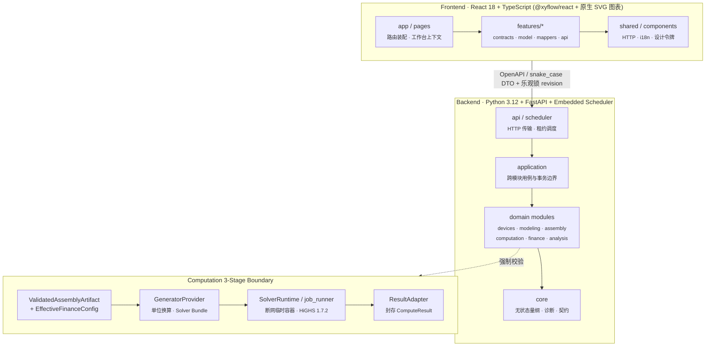

<div align="center">
  

  <h1>pIES — 综合能源系统规划与工程决策平台</h1>

  <p>
    <strong>面向低碳园区与建筑的多能互补拓扑建模、8760 小时联合优化与嵌入式工程财务决策平台</strong><br />
    <em>透明物理机理 · 声明式约束建模 · HiGHS 混合整数规划 · 同源不可变财务与报告交付</em>
  </p>

  <p>
    <a href="LICENSE"></a>
    
    
    
    
    <a href="manual/changelog/README.md#当前版本状态"></a>
  </p>

  <p>
    <strong>简体中文</strong> · <a href="README.en.md">English</a> &nbsp;|&nbsp;
    <a href="#-真实系统全流程动态演示">实景演示</a> ·
    <a href="#-为什么选择-pies">核心价值</a> ·
    <a href="#-核心工程特性">工程特性</a> ·
    <a href="#%EF%B8%8F-声明式内核与开放架构">开放架构</a> ·
    <a href="#-3-步快速上手docker">快速部署</a> ·
    <a href="#-统一文档与规范入口">正式文档</a>
  </p>

  <br />

  
</div>

---

## 🎬 真实系统全流程动态演示

以下动态演示与界面截图全部来自 **园区综合能源规划项目** 实测算例（电网 `20 MW` + 光伏 `3,125 kW` + 储能 `5,000 kWh / 2,500 kW` + 14 组 30 分钟负荷/光伏/分月电价 CSV，内置 **HiGHS 1.7.2 MILP** 全局优化至 `Gap 0.0%`）：

<p align="center">
  
</p>

### 实景界面速览（建模 · 规划 · 求解 · 时序曲线）

<table>
  <tr>
    <td width="50%" align="center">
      <br />
      <sub><strong>1. 声明式多能网络画布与参数抽屉</strong> — <code>grid</code>（20 MW）、<code>pv_existing</code>（3.125 MW）、<code>battery</code>（5,000 kWh / 2,500 kW）连接与存量/新增混装</sub>
    </td>
    <td width="50%" align="center">
      <br />
      <sub><strong>2. 系统技术方程与规划目标</strong> — 显式声明 <code>system_equations: allocation</code> 分配规则与 <code>maximize system.after_tax_npv</code> 优化目标</sub>
    </td>
  </tr>
  <tr>
    <td width="50%" align="center">
      <br />
      <sub><strong>3. 不可变求解证据与长周期评价</strong> — 14 组 30min 数据同次优化，<code>E=26 (K=1, N=25)</code> 收敛至 <code>Gap 0.0%</code> 与最优性认证</sub>
    </td>
    <td width="50%" align="center">
      <br />
      <sub><strong>4. 438,288 步高分辨率调度曲线</strong> — 原始步长不抽稀窗口浏览（<code>step 0–999</code>），直观观测光伏峰值、电网交互与储能协同波形</sub>
    </td>
  </tr>
</table>

---

## 💡 为什么选择 pIES？

园区与建筑综合能源系统正从单一供能走向“源网荷储”多能互补，但规划团队与研究人员常常面临两难：**商业软件黑盒不可审计，手工 Excel 又难以统筹 8760 小时耦合调度与税务现金流**。pIES 以同一套透明的物理模型与财务事实，把图形化建模、数学规划与经济评价连成可追溯的完整闭环：

| 对比维度 | 传统商业黑盒 / 手工 Excel 拼表 | pIES 一体化闭环方案 |
| :--- | :--- | :--- |
| **多能拓扑与量纲** | 电、热、冷专业割裂建模，单位换算易遗漏 | 统一电/热/冷/气端口拓扑，后端装配门禁强制校验量纲、方向与接口闭合 |
| **容量与调度耦合** | 典型日估算或先定容量后模拟，难以发现峰谷套利极限 | 8760h（或 15/30/60 min 分辨率）连续步调度与设备容量 **HiGHS MILP** 同次联合求解 |
| **电价与税务口径** | 静态平均电价、手工外挂折旧与退税表，易与调度脱节 | 地区 `FinanceProfile` + 项目覆盖生成不可变财务快照；两部制自然月最大需量、VAT 抵扣池、计税折旧直接参与规划求解 |
| **证据追溯与交付** | 改完模型覆盖原表，界面数值与上报 Excel 常有出入 | `CalcSnapshot` 不可变封存；页面、规划解回写与双语 Excel 报告严格消费同一份证据包 |

---

## 🚀 核心工程特性

1. **高保真多能设备与混合装配**：内置光伏（`pv`）、电化学储能（`battery`）、热泵（`heat_pump`）、燃气锅炉（`gas_boiler`）、电制冷机（`electric_chiller`）、电网连接（`grid_connection`）及多类负荷模型；支持项目内自定义模板（[模型与算法](manual/developer-guide/zh-CN/customization-center.md)）与存量/新增混合配置。
2. **8760h 时序数据集与质量诊断**：支持标准化 365 天非闰年 CSV 上传与内置园区样例数据一键生成，提供逐行结构诊断与固定 UTC 偏移检查。
3. **全周期工程财务与四维评价**：支持建设期分期付款（`payments`）、运营期大修换新（`maintenance_expenses`）、静态/动态回收期、NPV、FIRR 分类状态及[基准差额对比](manual/user-guide/zh-CN/results-and-exports.md)，严格区分税务与含税口径边界（详见[概念、单位与当前限制](manual/user-guide/zh-CN/concepts-and-limits.md)）。
4. **Git 级版本演进与离线项目包**：规划解可一键回写生成不可变新版本（`Revision`），并支持完整项目打包（`.zip`）导出及带冲突提案的离线导入。

---

## 🛠️ 声明式内核与开放架构

pIES 从底座设计上追求**开放优先于效率、正确性优先于兼容、边界公开可验证**，无论是扩展新的设备方程与求解算法，还是长期维护与二次集成，都能在清晰的静态边界内演进：



- **声明式约束与方程扩展**：通过 `system_equations`、`step_relation`（跨步储能/爬坡/蓄热耦合）和 `amount_relation`（财务分量与目标约束）表达复杂工艺与规则，无需修改通用调度或求解运行时。
- **零信任猜测边界**：后端统一校验设备 YAML、装配 YAML、财务 JSON 与计算配置；前端只维护展示状态与未提交草稿，409 并发冲突与 422 字段级诊断均保留现场输入。
- **开箱即用的自动化质量门禁**：
  - 后端 [test_architecture_gates.py](backend/tests/test_architecture_gates.py)：通过纯 Python AST 静态扫描强制锁死 `core`、领域层、`application`、`api` 与 `worker` 间的所有跨层穿透；
  - 前端 27 组纯逻辑单元测试（[frontend/tests/](frontend/tests/)）与帮助中心静态清单构建校验。

---

## ⚡ 3 步快速上手（Docker）

项目采用完整容器化编排，收敛为 **5 个常驻核心容器**（`postgres` + `redis` + `job_runner` + `backend` + `web`）以及首次启动自动构建的一次性 `builtin_stages` 内置计算镜像（`pies-builtin-stages:1.2.0`），宿主机无需安装 Python、Node 或 HiGHS 依赖。

### 1. 一键构建并启动全套服务

```bash
git clone https://github.com/ThermalEng/pIES.git
cd pIES
docker compose up -d --build
```

> [!NOTE]
> **从 `1.1.0` 升级提示**：`1.1.5` 已将原常驻 `io_worker` 与 `compute_worker` 收敛进 `backend` 嵌入式调度器与断网临时计算容器（由 `job_runner` 代理拉起）。从 `1.1.0` 升级时请执行以下命令以清理已退役的旧 Worker 容器：
> ```bash
> docker compose up -d --build --remove-orphans
> # 或先清理旧编排再重新拉起：
> # docker compose down --remove-orphans && docker compose up -d --build
> ```

服务就绪后（可通过 `curl http://localhost:8080/api/readyz` 确认数据库、存储与设备/求解器注册表状态）：
- **Web 控制台**：`http://localhost:8080`
- **内置离线帮助中心**：`http://localhost:8080/help/`（前端构建期直接从 `manual/` 生成，后端不可用时仍可静态阅读）

### 2. 登录与体验内置园区算例

- 默认种子管理员账号为 `admin`，初始密码由环境变量 `IESPLAN_DEFAULT_ADMIN_PASSWORD` 指定（首次登录强制要求修改密码）。
- 建议使用普通规划账号创建项目，依次体验：**拖拽搭建多能拓扑 → 生成内置 8760h 样例数据 → 引用财务画像并绑定成本/电价 → 运行全项目校验 → 提交 HiGHS 规划任务 → 查看封存结果与导出双语 Excel**。

### 3. 运行测试与架构门禁（均在 Docker 内）

```bash
# 后端架构门禁与单元测试
docker compose exec backend pytest tests/test_architecture_gates.py

# 前端构建与逻辑单元测试
docker build --target build -f frontend/Dockerfile -t pies-fe-check . && \
  docker run --rm pies-fe-check node scripts/run-logic-tests.mjs
```

> [!CAUTION]
> **生产安全提示**：上线前必须更换默认管理员密码、数据库凭证与 `IESPLAN_SECRET_KEY`，并在反向代理层配置 HTTPS。完整配置项与临时计算容器隔离参数见 [部署与运行指南](manual/developer-guide/zh-CN/deployment.md)。

---

## 📚 统一文档与规范入口

本仓库以 [`manual/`](manual/README.md) 作为唯一长期正式正文来源（网页“帮助中心”同步托管该目录）：

| 文档入口 | 核心内容 |
| :--- | :--- |
| 📖 **[使用者指南](manual/user-guide/README.md)**（[中文](manual/user-guide/zh-CN/README.md) \| [EN](manual/user-guide/en-US/README.md)） | 登录会话、画布建模、CSV 数据准备、财务/规划配置、任务排查与 Excel 导出操作手册 |
| 🛠️ **[开发者指南](manual/developer-guide/README.md)**（[中文](manual/developer-guide/zh-CN/README.md) \| [EN](manual/developer-guide/en-US/README.md)） | [架构宪法](manual/developer-guide/zh-CN/ARCHITECTURE_CONSTITUTION.md)、[系统蓝图](manual/developer-guide/zh-CN/architecture.md)、[文件格式契约](manual/developer-guide/zh-CN/file-formats.md)、[前端规范](manual/developer-guide/zh-CN/frontend.md) 与 [部署指南](manual/developer-guide/zh-CN/deployment.md) |
| ⏱️ **[更新日志与 Roadmap](manual/changelog/README.md)**（[中文 Roadmap](manual/changelog/roadmap.md) \| [EN Changelog](manual/changelog/en-US/README.md) \| [EN Roadmap](manual/changelog/en-US/roadmap.md)） | 按时间倒序记录的已验收版本事实与下一阶段演进计划 |

---

## 🗺️ 开发状态与开源许可

- **当前版本**：正式发布版本 **`1.2.0`**（[pyproject.toml](backend/pyproject.toml)，已完整交付开放模型与算法生态、`pIES Market` 无状态投稿/索引分发、`13` 字段单向流水线与 4 项参考设备模型及 4 项参考算法插件），详见 [更新日志](manual/changelog/README.md) 与 [Roadmap](manual/changelog/roadmap.md)。
- **开源协议**：本项目基于 **[Mozilla Public License 2.0 (MPL-2.0)](LICENSE)** 开源发布。

<p align="center">
  <sub>Copyright © 2026 pIES Contributors · Built for transparent, auditable Integrated Energy System planning.</sub>
</p>
